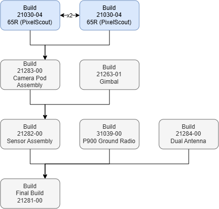
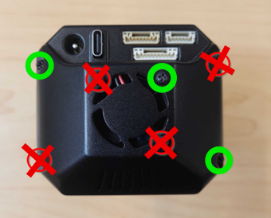

# 🚧 21030-04 -- 65R

<figure><figcaption></figcaption></figure>

## Drawing


[#id-65r-greater-than-21030](../../../../space-and-general/drawings.md#id-65r-greater-than-21030)


## Guide



### Assembly (1/2)


Leave the back cover detached for programming

Stop assembly just before installing the button.



[65r-assembly.md](../../../../production-documentation-1/65r/65r-assembly.md)




### Programming


[65r-programming.md](../../../../production-documentation-1/65r/65r-programming.md)


* Attach the back cover with two screws on the edge and one through the fan

<figure><figcaption></figcaption></figure>



### Focusing


[focusing-21030-04-65r.md](focusing-21030-04-65r.md)


<figure><figcaption></figcaption></figure>




### Bad Pixel Replacement


[65r-bad-pixel-replacemnt.md](../../../65r/65r-bad-pixel-replacemnt.md)


* Upload BPR folder to Taurus



### Assembly (2/2)

* Continue 65R assembly instructions to the end


The back cover can be left off until the Camera Pod Assembly step when the micro-coax cables are attached



[65r-assembly.md](../../../../production-documentation-1/65r/65r-assembly.md)




## Next Step:


[21283-00-camera-pod-assembly.md](../21283-00-camera-pod-assembly.md)

