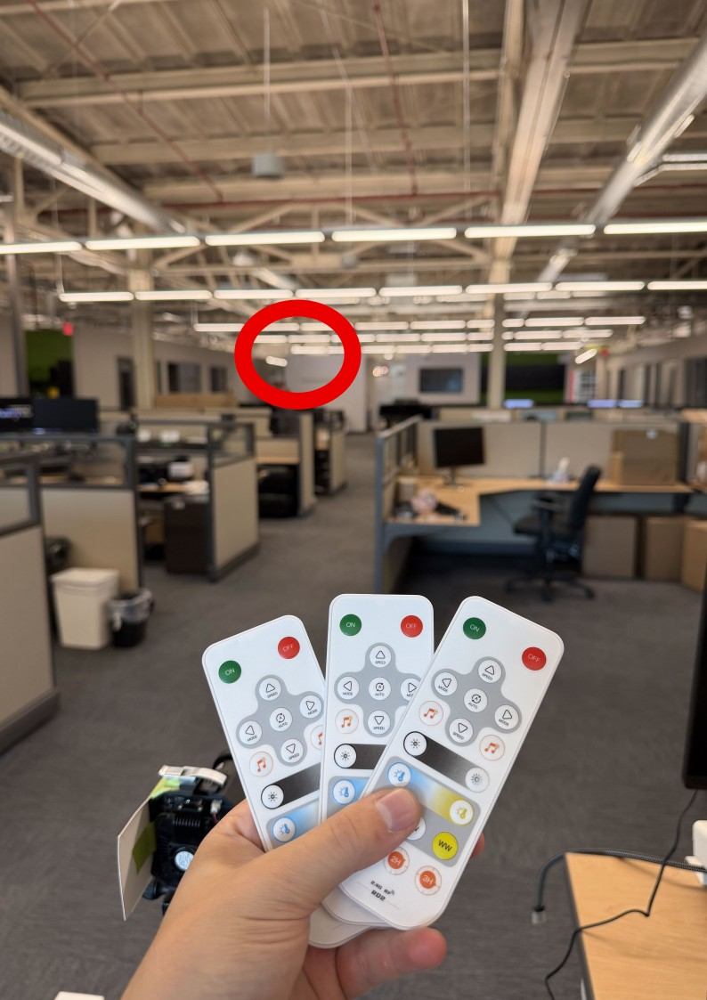
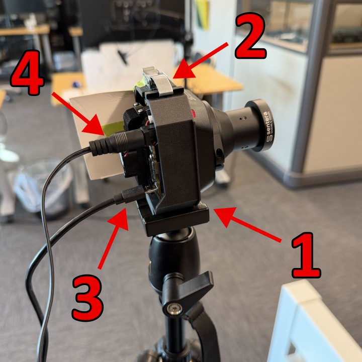
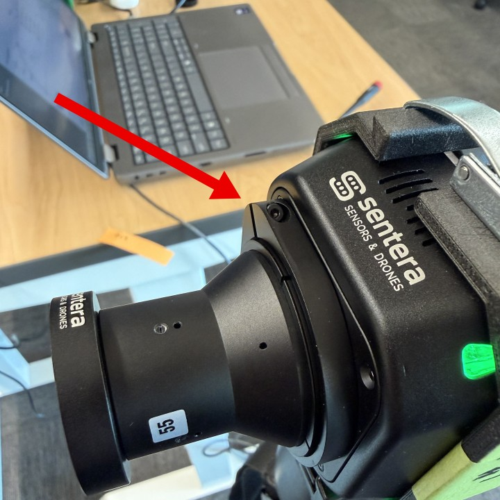

# 🚧 Focusing: 21030-04 -- 65R

## Notes:

## Prep:

### Equipment Needed:



* [ ] Micro USB Cable
* [ ] 24V power supply
* [ ] Laptop



* [ ] 1.5 Hex Screwdriver
* [ ] Tripod
* [ ] Camera Mount



## Guide:



### Setup the focusing station

* Turn on lights
  * Ensure all three light strips power on
  * You may need to walk down the isle for a better signal

<figure><figcaption>
Receiver circled in red
</figcaption></figure>

* Set up camera
  1. Attach 65R mount to the tripod
  2. Align and latch the camera in the mount
     * There are two small dots on the lower part of the mount that align with screw holes on the 65R
  3. Plug in USB
  4. Plug in 24V power

<figure><figcaption></figcaption></figure>



### Connect to camera

* In a web browser go to <mark style="color:blue;">`192.168.5.141`</mark>
* In the <mark style="color:blue;">`Home`</mark> tab, name the session "<mark style="color:blue;">focus</mark>" and click <mark style="color:blue;">`Start Session`</mark>

<figure><figcaption></figcaption></figure>

* In the <mark style="color:blue;">`Image Adjustments`</mark> tab, change the following settings and click <mark style="color:blue;">`Apply`</mark>
  1. Exposure:
     1. Exposure Target: 60 dn
     2. Shutter MIN: 4,000 us
     3. Shutter MAX: 10,000 us
     4. Shutter Unlock: 100 ISO
  2. Color Adjustments
     1. Brightness: -1 dn
  3. Pipeline
     1. Image Sharpening: OFF

<figure><figcaption></figcaption></figure>



### Focus

*   Loosen hex using a 1.5 hex screwdriver

    <figure><figcaption></figcaption></figure>
* Twist lens in/out until sharp focus
  * Twisting the lens in focuses further away
  * Twisting the lens out focuses closer
  * ¼ turns can be used for large focus changes
  * small (<20°) rotations should be used for fine focus
* Bottom right three bars should be distinct
  * \[INSERT EXAMPLE IMAGES]
* Tighten hex in correct orientation
* Check left & right
* Tilt down and check top focus area
* Tilt up and check bottom focus area.
* Take cap photo
* Download "Focus" session folder to Taurus
* Power off



### Wrap up

* Upload session to Taurus
* Label "top", "middle", "bottom", and "cap" photos and place them alongside the "Focus" session folder in the top directory



## Next Step:
