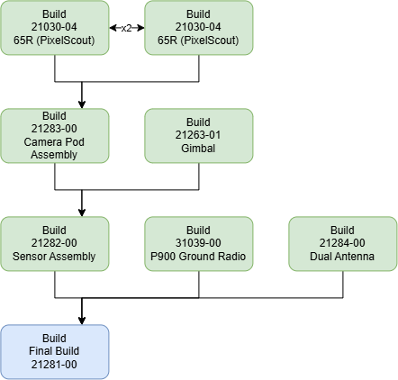

# 🚧 21281-00 -- Final Build

<figure><figcaption></figcaption></figure>

## Drawing:


[#pixelscout-v4-case-greater-than-21281](../../../space-and-general/drawings.md#pixelscout-v4-case-greater-than-21281)


## Notes:

## Prep:

## Guide:



### Emlid




### Case




### Packing




## Next Step:
