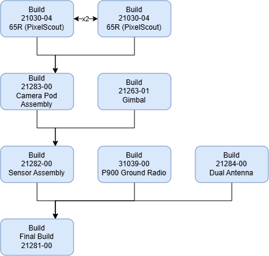

# 🚧 PixelScout overview & setup

<figure><figcaption></figcaption></figure>

## Taurus Prep:

In preparation of assembling a PixelScout unit, setup the following directories:

65R Sensor (21030-04)

Create the <mark style="color:green;">initial directories</mark> at the 65R path as shown below:


65R Sensor (21030-04) directory path:

\as-taurus.jdnet.deere.com\Production\Sensors\21030-XX -- 65R Sensor\21030-04


Final directory layout: (<mark style="color:green;">initial directory</mark>, <mark style="color:$warning;">progress directory</mark>, <mark style="color:orange;">shortcut</mark>, <mark style="color:blue;">file</mark>)

<mark style="color:green;">###</mark> (65R s/n)

* <mark style="color:$warning;">BPR\_###</mark>
  * <mark style="color:$warning;">BPR\_###\_bad\_pixels</mark>
    * <mark style="color:blue;">bad\_pixel\_details.csv</mark>
    * <mark style="color:blue;">bad\_pixels\_mask.tif</mark>
    * <mark style="color:blue;">bpr\_map.csv</mark>
    * <mark style="color:blue;">image\_summary.csv</mark>
    * <mark style="color:blue;">transient\_pixels.csv</mark>
  * <mark style="color:blue;">img\_bayer\_brignt\_##.tif</mark> (45, 100, 255)
  * <mark style="color:blue;">img\_bayer\_dark\_##.tif</mark> (0, 45, 100)
* <mark style="color:$warning;">Focus</mark>
  * <mark style="color:$warning;">rgb</mark>
    * <mark style="color:blue;">IMG\_0001.jpg</mark>
* <mark style="color:blue;">bottom.jpg</mark>
* <mark style="color:blue;">cap.jpg</mark>
* <mark style="color:blue;">middle.jpg</mark>
* <mark style="color:blue;">top.jpg</mark>

PixelScout V4 (21282-00)

Create the <mark style="color:green;">initial directories</mark> and <mark style="color:orange;">shortcuts</mark> at the PixelScout path as shown below:


PixelScout V4 (21282-00) directory path:

\as-taurus.jdnet.deere.com\Production\Systems & Kits\21282-00 -- PixelScout Phase 4


Final directory layout: (<mark style="color:green;">initial directory</mark>, <mark style="color:$warning;">progress directory</mark>, <mark style="color:orange;">shortcut</mark>, <mark style="color:blue;">file</mark>)

<mark style="color:green;">###</mark> (PixelScout V4 s/n)

* <mark style="color:green;">Calibration</mark>
  * <mark style="color:green;">###\_primary</mark> (Primary 65R s/n)
    * <mark style="color:$warning;">\[session]</mark>
    * <mark style="color:$warning;">\[session]\_cal</mark>
    * <mark style="color:$warning;">\[session]\_cal\_out</mark>
    * <mark style="color:$warning;">\[session]\_out</mark>
    * <mark style="color:$warning;">\[session]\_pix4d</mark>
    * <mark style="color:$warning;">info</mark>
    * <mark style="color:blue;">\[session].p4d</mark>
  * <mark style="color:green;">###\_secondary</mark> (Secondary 65R s/n)
    * same as Primary
* <mark style="color:green;">Verification</mark>
  * <mark style="color:green;">###\_primary</mark> (Primary 65R s/n)
    * <mark style="color:$warning;">\[session]</mark>
    * <mark style="color:$warning;">\[session]\_val\_out</mark>
    * <mark style="color:$warning;">info</mark>
  * <mark style="color:green;">###\_secondary</mark> (Secondary 65R s/n)
    * same as Primary
* <mark style="color:blue;">sbgc\_IMU\_calib\_phase4SN###.data</mark>
* <mark style="color:blue;">sbgc\_IMU\_calib\_phase4SN###.data</mark>
* <mark style="color:orange;">sensor\_###</mark> (shortcut to Primary 65R Taurus directory)
* <mark style="color:orange;">sensor\_###</mark> (shortcut to Secondary 65R Taurus directory)

## Builds:

## Next Step:


[21030-04-65r](21030-04-65r/)

