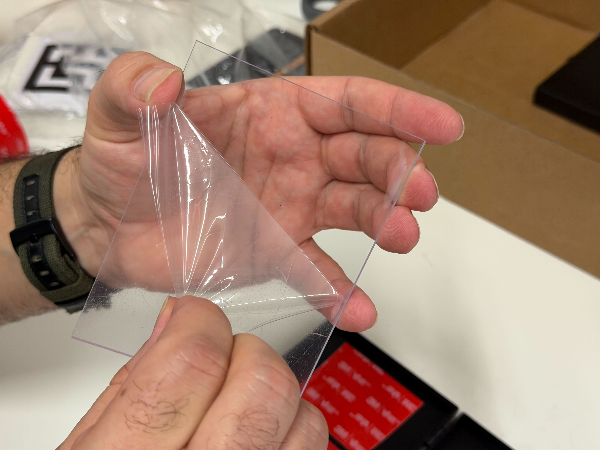
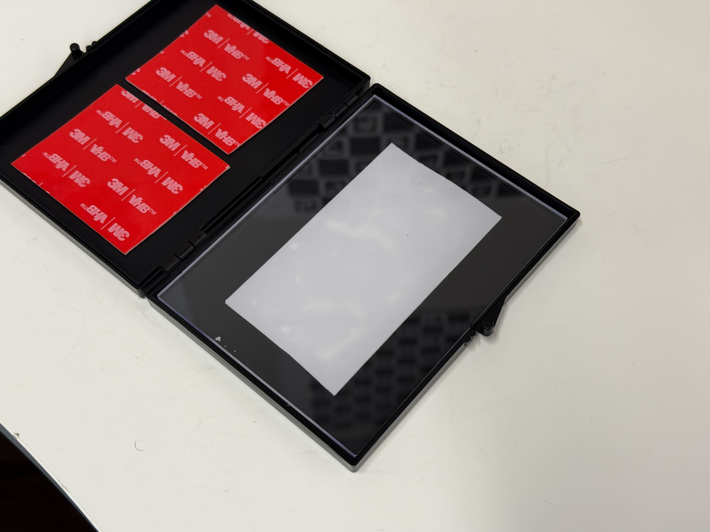
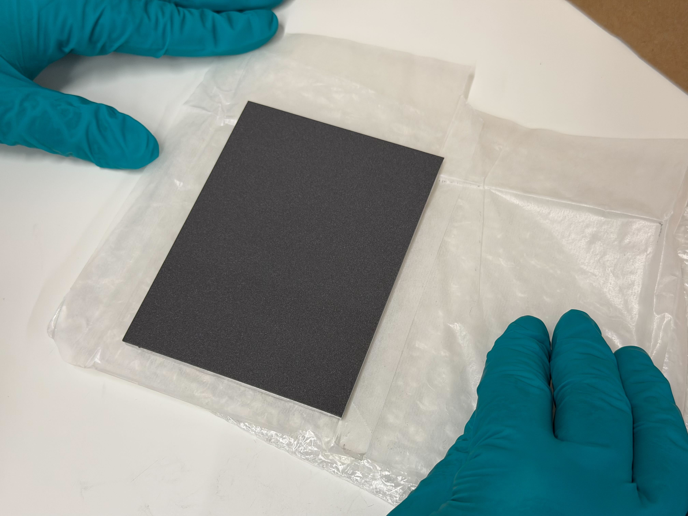
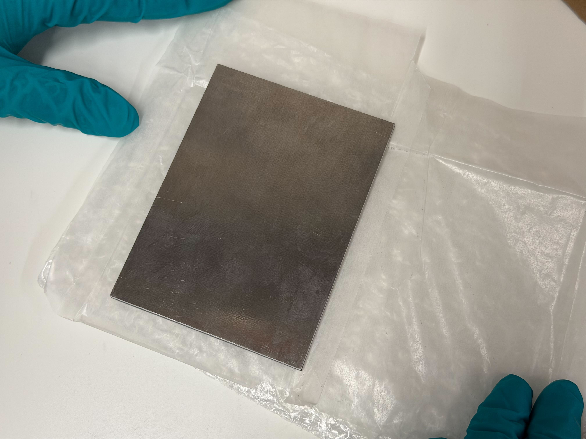
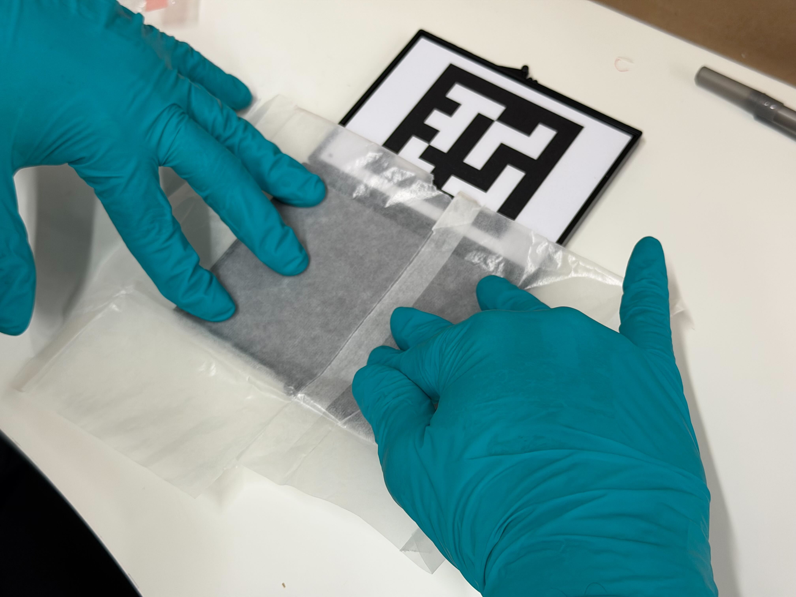
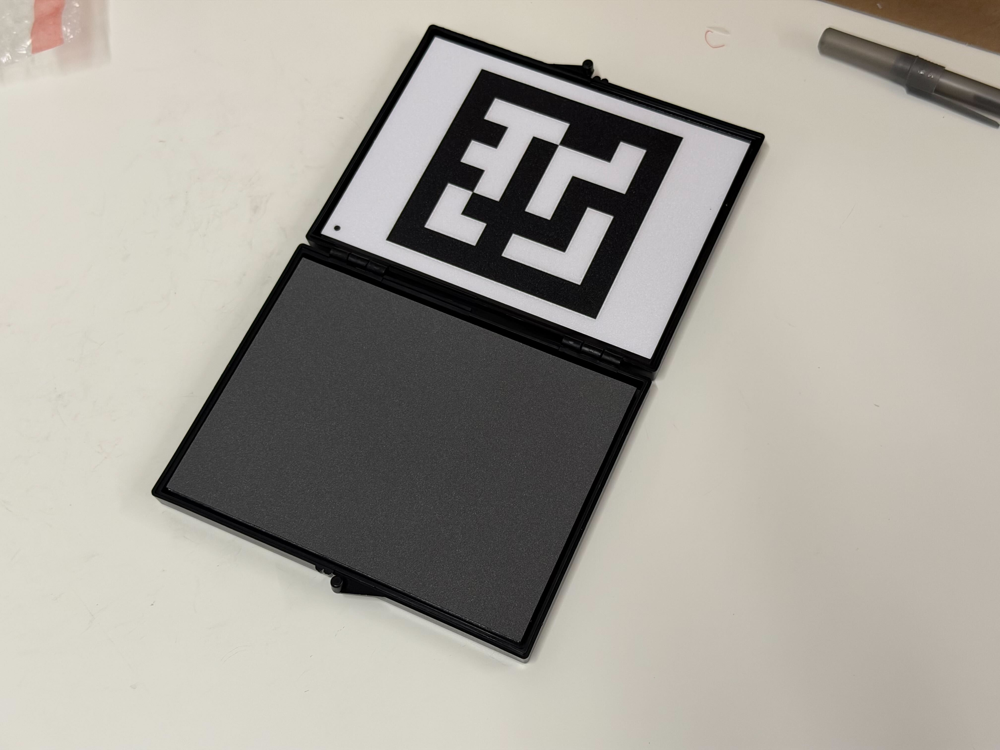
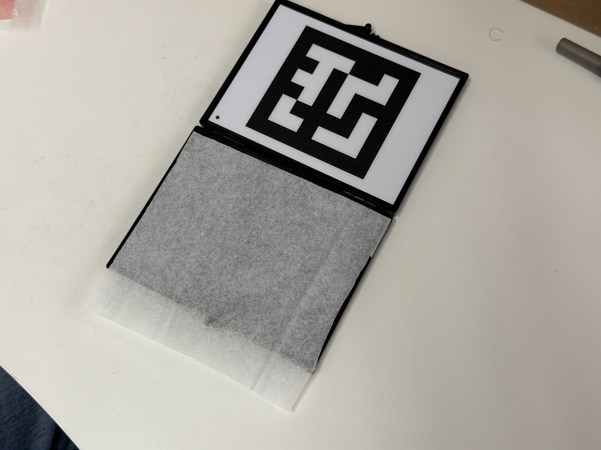
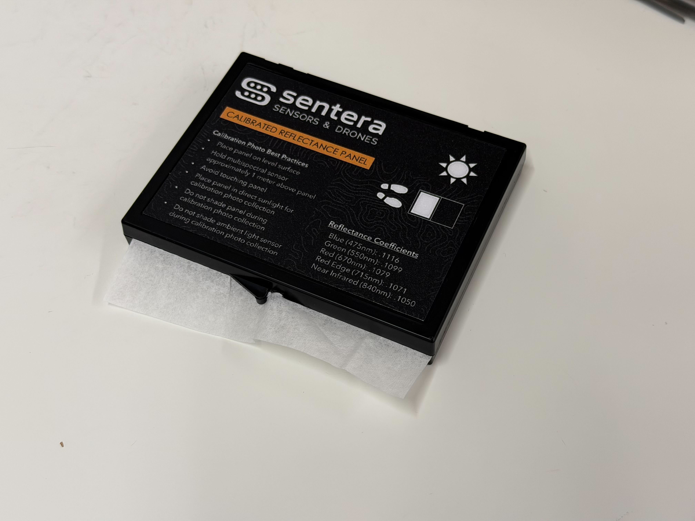

# 🚧 Reflectance Panel Assembly

## Equipment

|              |                      |
| ------------ | -------------------- |
| Latex Gloves | Box Cutter Blade     |
| 3M Tape      | Blue Cleaning Paper  |
|              | Acetone              |

## Notes

Before starting, ensure someone else will be able to QC the panels within 24 hours

## Prep

* Clear workspace and wipe down with cleaning spray or wipes to ensure area is cleaned.
* Gather all materials necessary

## Guide

1. Cases should come with the outside Sentera sticker and an inside QR code already installed.&#x20;

If stickers are not pre-installed. Follow these steps. 

* If present, remove any stickers with acetone and foam from the cases
*

    <figure><figcaption></figcaption></figure>
*   Cut Strips of foam tape and attach to the inside faces of the containers as shown, ensuring edges of the tape match closely with the container walls

    <figure><figcaption></figcaption></figure>
* Remove adhesive covering from each **upper** strip of tape and film from **both** sides of the polycarbonate sheet.
  1.  One of the pieces of film on the polycarbonate sheet is very transparent. Ensure **both** films are removed.

      <figure><figcaption></figcaption></figure>
* Place the polycarbonate sheet in the **upper** section, applying even pressure to ensure secure attachment.

<figure><figcaption></figcaption></figure>

* Place QR code sticker the upper part of the case. Ensure the black dot is in the lower left corner.&#x20;

<figure><figcaption></figcaption></figure>

2. Wipe the bottom half with Acetone to clean up any dirt or debris and apply 2 strips of the 3M tape to the lower section of the case. The tape strips should be about 1/4" away from the edges.

<figure><figcaption></figcaption></figure>

3. Remove red film from tape in the lower section.
4. **Put on a new pair of disposable latex gloves**.
5. Carefully remove the reflectance panel from its packaging.
6. Place the '**Metallic Side**' of the panel down on the bottom adhesive 3M tape strips. Slightly press down with pressure using both your palms.



<figure><figcaption></figcaption></figure>

Reflectance Side



<figure><figcaption></figcaption></figure>

Metallic Side



7. Press down to make sure the 'metallic side' sticks using the inside of the original panel packaging as it is clean and free of oils and debris.



<figure><figcaption></figcaption></figure>



<figure><figcaption></figcaption></figure>




8. Place a Kimwipe tissue paper over the reflectance panel with it overlapping the front.

<figure><figcaption></figcaption></figure>

9. Close the panel with the Kimwipe tissue paper ready for QC.&#x20;

<figure><figcaption></figcaption></figure>
