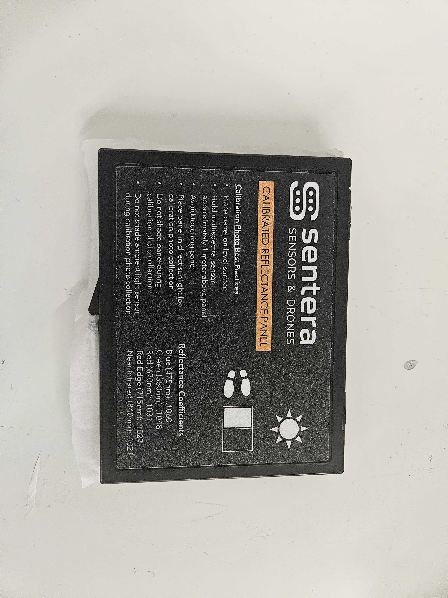
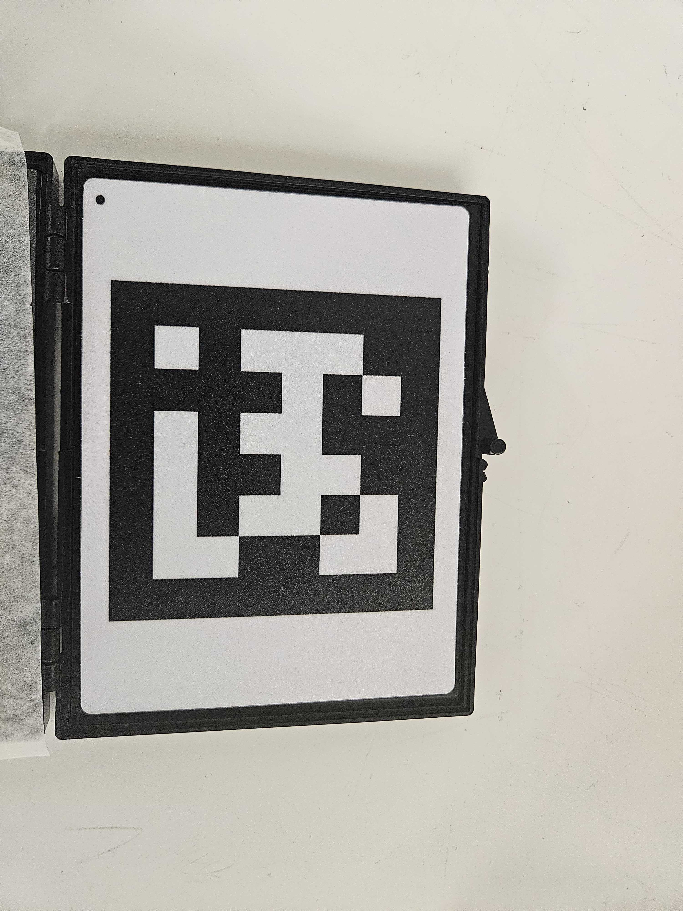
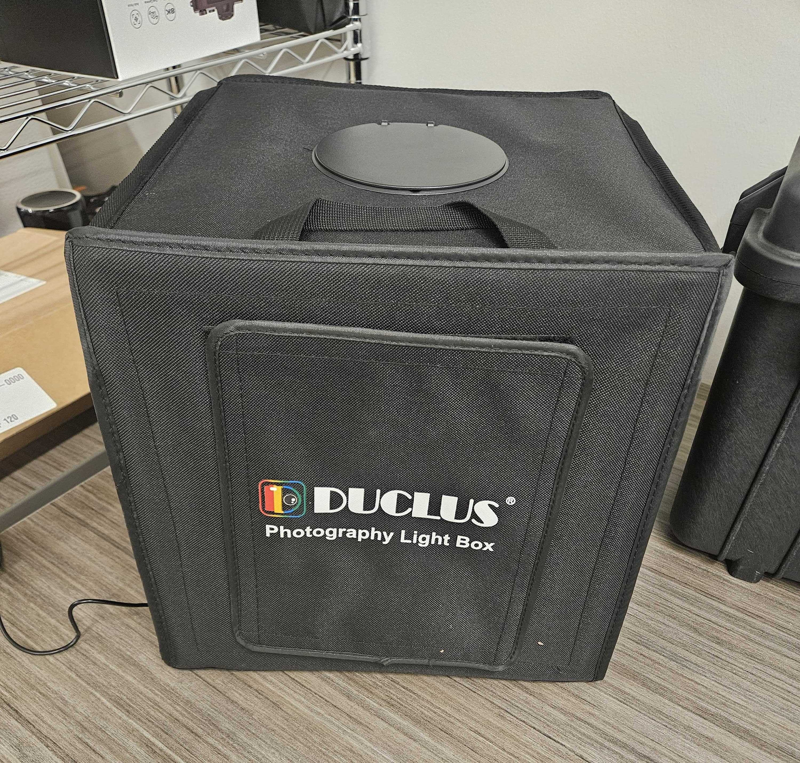
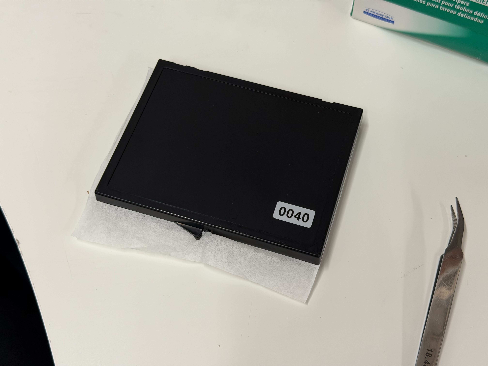
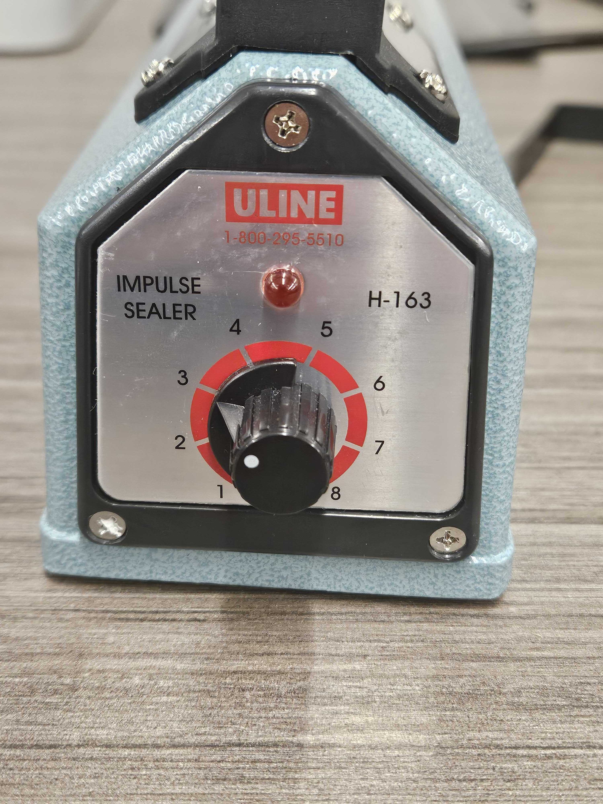
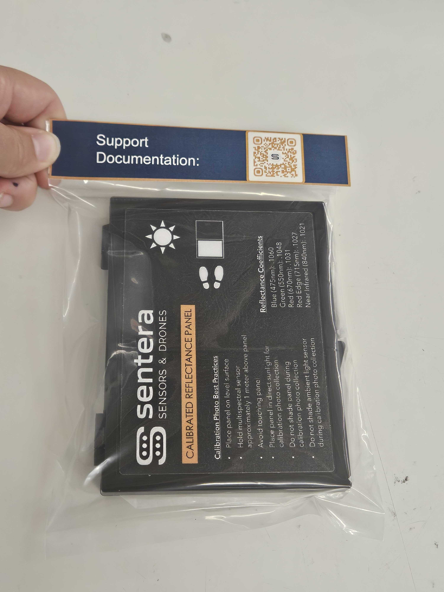

# 📷 Reflectance Panel QC

## Notes

## QC Steps

1. Put on a pair of latex gloves.
2. Open a reflectance panel, inspect the reflectance panel for any nicks, gouges, discoloration, etc.
   1. If any damage is present, put aside and consult with others for ship-ability
   2. Confirm 3M tape is not visible.
   3. Confirm stickers are correctly installed

>     
>
>

3. Select the next number sticker. Temporarily stick it on the top right edge of the open panel, ensuring it is not covering any part of the reflectance panel.


Only use the stickers in the 'Reflectance Panel' Bin. Please place the sticker roll back in the correct bin.&#x20;

&#x20;                                                       **DO NOT USE THE ASTRO BIN STICKER**


4. Locate the 'Small' light box in the room to take a photo of the Reflectance Panel:

<figure><figcaption></figcaption></figure>

* Panel serial number is visible, and the entire panel is in view.
* Every picture is visible with NO blur.

<figure><figcaption></figcaption></figure>

5. Close the container with the Kimwipe tissue paper placed back in between the two halves of the container with an even overhang.
6. Place the sticker on the back of the case, position it in the lower right-hand corner on the inside of the boarder section. <mark style="color:$danger;">(Replace picture)</mark>

<figure><figcaption></figcaption></figure>

7. Place the panel into an S-9482 Poly Bag and seal with the Uline Sealer.
   1.  Impulse Sealer should be set to 3. Place the panel in the bag with Sentera sticker side first so that the sticker is furthest from the excess material.

       <figure><figcaption></figcaption></figure>
8. Grab a folded "Sentera Documentation" and staple it on both sides of the bag to keep it secured.&#x20;

> .png>)     

9. Upload photos to Taurus with the panel serial number as the photo name.
   1. \\\taurus\Production\Systems & Kits\21226-00 — Reflectance Panel.
   2. Photo naming convention: "Panel XXXX" where XXXX is the serial number on the sticker.
