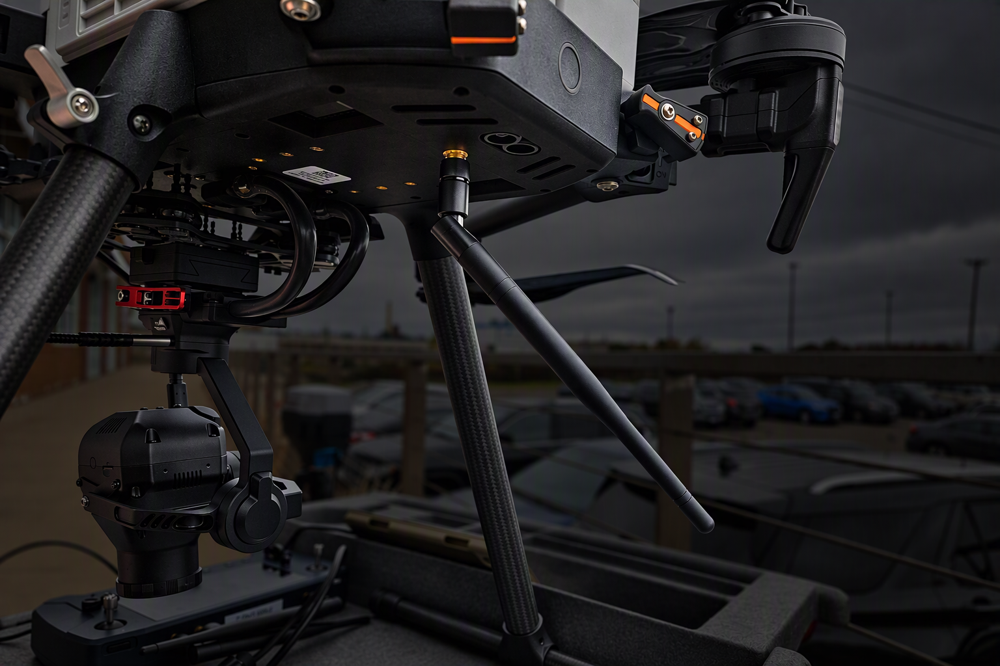

# 📷 Setup for Module Testing

## Equipment needed

|                                        |                                 |                                                  |
| -------------------------------------- | ------------------------------- | ------------------------------------------------ |
| Emlid Reach App                        | Anker battery for controller    | Production Emlid Reach RS2+                      |
| MNcors account                         | IF800 Drone with full batteries | Production 65R                                   |
| Computer                               | RTK/PPK customer cords          | Type C to C cable for computer to 65R connection |
| Air module with matching ground module | Module checkout pages           | Orange clipboard                                 |

## Prep

* Print out one 27300\_Sentera\_RTK\_PPK\_Module\_Checkout document for each module being tested.



* Ensure emlid is charged at least halfway. Might need more/less charge depending on amount of modules being tested.&#x20;

## Module Testing

### Top Part

1. Fill out the top part of the Sentera RTK PPK Module Checkout document.

<figure><figcaption></figcaption></figure>

### System Setup

1. Follow the 'System Setup - Indoors, Sensor Setup' part of the document.
   1. Sensor type: better with 65R as there are less photos taken which shortens transfer time
   2. Aircraft Type: For an IF1200 build, the IF800 drone can be used.&#x20;
   3. GEN II Markings: Located at the bottom of the stack closest to sensor.

<figure><figcaption></figcaption></figure>

### Aircraft Setup


Check off sheet as you go through the steps


1. **Install Sensor onto aircraft:** attach the sensor (6X/65R) to the drone using the smart dovetail connection. Verify it clicks into place and flip the level to lock it in place.
2. **Install module aircraft:** Attach RTK Air module to the top of the drone using 4 thumb screws. Install finger tight. Just enough to keep the module from moving.
3. **Connect coax cable to module and aircraft:** Connect the copper colored coax cable to the Air module on top of the aircraft. Depending on the intended aircraft, connect the other end as follows:



<figure><figcaption></figcaption></figure>

IF800

Plug into the side of the aircraft body




<mark style="color:$danger;">Insert IF1200 Image of coax connection</mark>



4. **Install 900Mhz antenna to aircraft:** screw in the antenna as follows depending on the intended aircraft:



<figure><figcaption></figcaption></figure>

IF800

Screw the antenna into the underbody of the aircraft.




IF1200: Screw the antenna into the clamp adapter, leave it hanging unstructed.



5. **Connect module to sensor via USB-C to USB-C cable:** Connect the cable to the side of the air module and the side of the top stack of the sensor gimbal.&#x20;

<figure><figcaption></figcaption></figure>

### Aircraft Hand Controller Setup


Check off sheet as you go through the steps. This is a check to be performed at the beginning of testing. If testing multiple modules, complete on the first one.&#x20;


1. **Power on Hand controller:** Long hold for a couple of seconds
2. **Connect controller to hotspot/internet:** Use Ipad hotspot and connect controller to the Wifi
3. **Open IGC:** opens automatically
4. **Open NTRIP menu:** located top center, <mark style="color:$danger;">T</mark> Icon
   1. If not already entered in: Enter NTRIP credentials and select Mountpoint
5. Verifiy connection to NTRIP Network
6. Disconnect from NTRIP Network and power off

### Emlid Base Station Setup


Check off sheet as you go through the steps. This is a check to be performed at the beginning of testing. If testing multiple modules, complete on the first one.&#x20;


1. Extend legs fully, keep away from buildings
2. Power on&#x20;
3. Connect to base station
4. Verify base station output id set to USB OTG 115200
5. Connect ground radion to emlid using USB C-C cable (should be connected to emlid already)
6. Verify the ground radio has green scrolling LEDs
7. Power down


We skip "Laptop NTRIP" on the document. Please leave this section blank.&#x20;

